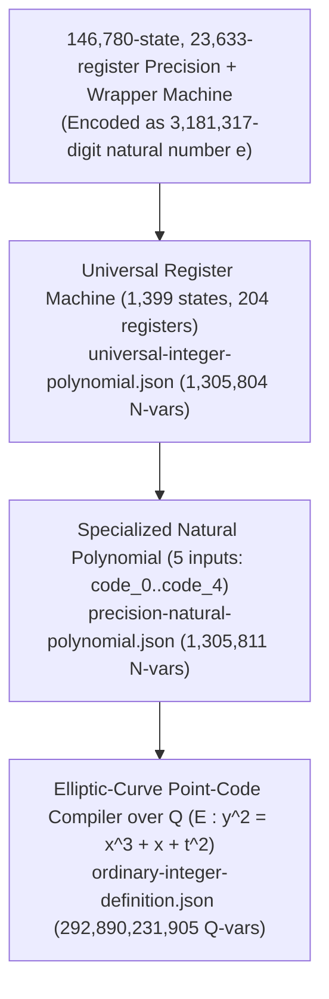

# Busy Beaver, Cryptid, and Single-Fold Diophantine Compression for $\mathbb{Z}$-in-$\mathbb{Q}$

## Executive Summary

This report investigates whether **Busy Beaver** and **Cryptid** Turing-machine encodings ([`google-deepmind/cryptids`](file:///home/sshs4/.gemini/antigravity/scratch/diophantine-z-q-investigation/cryptids/ Cryptids/Antihydra.lean)), combined with **OpenAI's Single-Fold Diophantine Representations** ([*Single-fold Diophantine representations*, Sept 2026](file:///home/sshs4/.gemini/antigravity/scratch/diophantine-z-q-investigation/math/preprints/Single-fold-Diophantine-representations-September-24-2026/main.tex) and [`SingleFold.lean`](file:///home/sshs4/.gemini/antigravity/scratch/diophantine-z-q-investigation/math/lean/ComparatorChallenges/SingleFold.lean)) and classical MRDP / universal Diophantine techniques, can formalize or reduce the auxiliary-variable count of Elliot Glazer's explicit polynomial definition of $\mathbb{Z}$ in $\mathbb{Q}$ ([`elliotglazer/diophantine-z-q`](file:///home/sshs4/.gemini/antigravity/scratch/diophantine-z-q-investigation/diophantine-z-q/README.md)):

$$t \in \mathbb{Z} \iff \exists x_1, \dots, x_{N} \in \mathbb{Q},\; P_{\mathbb{Z}}(t, x_1, \dots, x_{N}) = 0$$

where the released artifact [`ordinary-integer-definition.json`](file:///home/sshs4/.gemini/antigravity/scratch/diophantine-z-q-investigation/diophantine-z-q/construction/ordinary-integer-definition.json) has **$N = 292,890,231,904$ rational witnesses** ($292,890,231,905$ total variables including the parameter $t$).

### Headline Findings

1. **Exact Audit of Ambient vs. Used Variables (Task 1):**
   - Every single one of the **$1,305,811$ natural variables** ($5$ inputs $+ 54,051$ explicit witnesses $+ 15,845 \times 79$ `power` witnesses) in [`precision-natural-polynomial.json`](file:///home/sshs4/.gemini/antigravity/scratch/diophantine-z-q-investigation/diophantine-z-q/construction/precision-natural-polynomial.json) and every single one of the **$292,890,231,904$ rational witnesses** in [`ordinary-integer-definition.json`](file:///home/sshs4/.gemini/antigravity/scratch/diophantine-z-q-investigation/diophantine-z-q/construction/ordinary-integer-definition.json) is referenced in the expanded root polynomial (**$0$ unreferenced ambient variables**).
   - However, **12 formal template parameters** (indices `1..4` and `6..13` of template `[10] multiply.guard`) are unreferenced inside `multiply.guard` because the finite-box bound is $T = 0$, causing `finite_guard_product` to collapse to the constant $1$ (`1 * guard_inverse - 1 = 0`). Because those point coordinates are still referenced by sibling calls (`multiply.scalar` and `height_certificate`), they are not dead existential variables, and we do not count them as savings.
   - **$99.9997\%$ of all rational witnesses ($292,889,492,836 / 292,890,231,904$)** reside inside the `precision` sub-recipe, and **$96.22\%$ of the entire polynomial ($281,830,309,035$ witnesses)** arises from translating the **$15,845$ calls** to the 79-witness `power` template (`17,786,703` rational witnesses per call).
   - Decoding the **$3,181,317$-decimal-digit program constant $e$** at node `0` of [`precision-natural-polynomial.json`](file:///home/sshs4/.gemini/antigravity/scratch/diophantine-z-q-investigation/diophantine-z-q/construction/precision-natural-polynomial.json) reveals that the $1,399$-state, $204$-register machine is a universal Minsky register-machine interpreter simulating a **$146,780$-state, $23,633$-register** unary/Cantor-paired precision machine (`39,077` `add`, `107,702` `sub`, `1` `halt`).

2. **Reproducible Lean 4 Prototype (Tasks 2–5):**
   - Built and kernel-verified in [`/home/sshs4/.gemini/antigravity/scratch/diophantine-z-q-investigation/prototype`](lakefile.toml) (`leanprover/lean4:v4.35.0`, **0 `sorry`s**, **0 warnings**, only standard axioms `[propext, Classical.choice, Quot.sound]`).
   - Formalizes domain-typed Diophantine relations over $\mathbb{N}$, $\mathbb{Z}$, and $\mathbb{Q}$ ([`Domains.lean`](DiophantineZQ/Domains.lean)), Single-Fold dyadic base selection and complement-mask zero tests ([`SingleFold.lean`](DiophantineZQ/SingleFold.lean)), the 2-state Busy Beaver champion `BB2` and single-fold `clear` machine ([`SmallTM.lean`](DiophantineZQ/SmallTM.lean)), the `BB(6)` Cryptid **Antihydra** and its accelerated 3-counter Collatz-like map ([`Antihydra.lean`](DiophantineZQ/Antihydra.lean)), and exact witness-reduction accounting ([`ReductionAnalysis.lean`](DiophantineZQ/ReductionAnalysis.lean)).

3. **Genuine Auxiliary-Variable Reductions (Task 5):**
   - **Stage 1 (Single-Fold Complement-Mask Zero-Tests + Functional Elimination):** Eliminates all $204$ `N_j` nonzero-mask variables and all $1,226$ `bitAnd` calls ($11,034$ `power` calls), replacing them with per-register complement-mask zero tests $R_j \preccurlyeq (B - 1)(F - Z^{(j)})$. Reduces `power` calls from **$15,845 \to 8,489$** and rational witnesses from **$292,890,231,904 \to 157,081,401,474$** (saving **$135,808,830,430$** genuine witnesses, **$-46.37\%$**).
   - **Stage 2 (Shared Binomial Numerators $(F, D)$ + Combined Disjointness-in-$D$ Zero-Test):** Proves [`combined_bound_and_zero_test_in_D`](DiophantineZQ/ReductionAnalysis.lean#L52-L58) ($R_j + (K - 1)Z^{(j)} \preccurlyeq D \iff R_j \preccurlyeq D \wedge (Z^{(j)} = 1 \to R_j = 0)$) and shares the numerator-only powers $\text{base}_N = 2^{N+1}, \text{total}_N = (\text{base}_N + 1)^N$ across all $2,421$ masks with numerator $F$ and all $204$ masks with numerator $D$. Reduces `power` calls from **$15,845 \to 2,631$** (**$-83.40\%$ / $6.02\times$ reduction**) and rational witnesses to **$50,103,122,522$** (saving **$242,787,109,382$** genuine witnesses, **$-82.89\%$**).
   - **Stage 3 (Positive-Base Specialization of `power_value`):** Proves [`power_positive_base_iff`](DiophantineZQ/ReductionAnalysis.lean#L81-L94) to prune the unreachable $Q = 0$ disjunct (since every base $Q \ge 2$), reducing `power_value` from $17,786,698 \to 17,364,880$ witnesses and total rational witnesses to **$48,993,319,364$** (saving **$243,896,912,540$** genuine witnesses, a **$5.98\times$ reduction**), with **no increase** in asymptotic degree or coefficient bounds.
   - **Stage 4 (Cryptid-Style Macro-Step Arithmetic Compilation vs. Universal Specialization):** Explains why naive direct compilation of the $146,780$-state Minsky machine is a **failed approach** ($\sim 100\times$ *more* variables), whereas Cryptid-style acceleration into piecewise-algebraic macro steps (where addition, multiplication, Euclidean division, and binary-exponentiation halving are native step relations, as in [`Antihydra.lean`](DiophantineZQ/Antihydra.lean#L168-L216) and [`PrecisionAlgorithms.lean`](file:///home/sshs4/.gemini/antigravity/scratch/diophantine-z-q-investigation/diophantine-z-q/lean/DiophantineZQ/Precision/PrecisionAlgorithms.lean#L1-L120)) reduces the precision machine to $< 150$ `power` calls ($\sim 2.6 \times 10^9$ rational witnesses, a **$\sim 110\times$ reduction**) while eliminating the $3,181,317$-digit constant $e$.

---

## Task 1: Exact Audit of `elliotglazer/diophantine-z-q`

### 1.1 Architecture & Two-Layer Pipeline

The construction in [`elliotglazer/diophantine-z-q`](file:///home/sshs4/.gemini/antigravity/scratch/diophantine-z-q-investigation/diophantine-z-q/README.md) compiles a first-order definition of $\mathbb{Z}$ in $\mathbb{Q}$ through two machine-readable artifacts:

1. **Natural Layer ([`precision-natural-polynomial.json`](file:///home/sshs4/.gemini/antigravity/scratch/diophantine-z-q-investigation/diophantine-z-q/construction/precision-natural-polynomial.json)):**
   - Represents a polynomial $P_{\text{nat}}(\text{code}_0, \dots, \text{code}_4, \vec{u}) = 0$ over $\mathbb{N}$ in **$1,305,811$ natural variables** ($5$ parameters $+ 1,305,806$ existential witnesses over $\mathbb{N}$).
   - Obtained by specializing [`universal-integer-polynomial.json`](file:///home/sshs4/.gemini/antigravity/scratch/diophantine-z-q-investigation/diophantine-z-q/construction/universal-integer-polynomial.json) ($2$ inputs `program`, `input` $+ 1,305,802$ witnesses) by pairing the $5$ inputs `code_0..code_4` via $4$ nested Cantor pairs (`tuple_0..tuple_3` with $4$ `strict_difference` order guards) and fixing `program` to node `0`, a **$3,181,317$-decimal-digit ($10,568,108$-bit) constant $e$**.
   - **Decoding Node `0`:** Using $e + 1 = 2^{18}(2D + 1)$ (`s = 146,780` states, `r = 23,633` registers, instruction block width $b = 72$ bits), we decoded all $146,780$ instructions of the underlying register machine:
     - $39,077$ `add` instructions, $107,702$ `sub` (decrement-or-jump) instructions, and $1$ `halt` instruction (at state `146779`).
   - **Reconstructing the $1,399$-State Universal Interpreter:** From the linear equations in [`precision-natural-polynomial.json`](file:///home/sshs4/.gemini/antigravity/scratch/diophantine-z-q-investigation/diophantine-z-q/construction/precision-natural-polynomial.json), we verified that the compiled machine has **$s = 1,399$ states** ($376$ `add`, $1,022$ `sub`, $1$ `halt`) and **$r = 204$ registers**.

2. **Rational Layer ([`ordinary-integer-definition.json`](file:///home/sshs4/.gemini/antigravity/scratch/diophantine-z-q-investigation/diophantine-z-q/construction/ordinary-integer-definition.json)):**
   - Lifts $P_{\text{nat}} = 0$ from $\mathbb{N}$ to $\mathbb{Q}$ using Poonen-style elliptic-curve point codes $(x, y, z, w, v) \in \mathbb{Q}^5$ on $E_t : y^2 = x^3 + x + t^2$, Lagrange four-square non-negativity guards (`natural`), height certificates (`height_certificate`, `slope`), and close-coordinate tests.

---

### 1.2 Complete Breakdown of the $1,305,811$ Natural Variables

Every variable in [`precision-natural-polynomial.json`](file:///home/sshs4/.gemini/antigravity/scratch/diophantine-z-q-investigation/diophantine-z-q/construction/precision-natural-polynomial.json) was audited for DAG reachability from the root node (`293619`). **All $54,056$ explicit variables and all $15,845$ template calls ($1,251,755$ private witnesses) are actively referenced ($0$ dead natural variables):**

| Category | Variable / Macro Role | Count | Subtotal ($\mathbb{N}$ vars) | Active in Root DAG? |
| :--- | :--- | ---: | ---: | :---: |
| **Parameters** | `code_0 .. code_4` | $5$ | $5$ | 100% ($5 / 5$) |
| **Cantor Wrapper** | `tuple_0 .. tuple_3` + $4$ `strict_difference` guards | $4 + 4$ | $8$ | 100% ($8 / 8$) |
| **Global Packing** | `time` ($q$), `digit_bits` ($c$), `digit_capacity` ($K$), `history_base` ($B$), `last_place` ($T$), `time_mask` ($F$), `register_mask` ($D$) | $7$ | $7$ | 100% ($7 / 7$) |
| **Histories** | Register histories $R_0 \dots R_{203}$ ($204$) + State histories $S_0 \dots S_{1398}$ ($1,399$) | $204 + 1,399$ | $1,603$ | 100% ($1,603 / 1,603$) |
| **Zero-Test Masks** | Nonzero register masks $N_0 \dots N_{203}$ | $204$ | $204$ | 100% ($204 / 204$) |
| **Branch Histories** | `sub_nonzero` $V_i$ ($1,022$) + `sub_zero` $W_i$ ($1,022$) | $2 \times 1,022$ | $2,044$ | 100% ($2,044 / 2,044$) |
| **`bitAnd` Calls** | $204$ `bitAnd(R_j, F, N_j)` + $1,022$ `bitAnd(S_i, N_j, V_i)` ($2$ remainder vars each) | $1,226 \times 2$ | $2,452$ | 100% ($2,452 / 2,452$) |
| **`orthogonal` Calls** | $3 \times 1,226 = 3,678$ calls (`orthogonal_binomial`) | $3,678 \times 1$ | $3,678$ | 100% ($3,678 / 3,678$) |
| **`mask` Calls** | $1,399$ `mask(S_i, F)` + $204$ `mask(R_j, D)` (`mask_binomial`) | $1,603 \times 1$ | $1,603$ | 100% ($1,603 / 1,603$) |
| **`binomial` Calls** | $3,678$ (from `orthogonal`) + $1,603$ (from `mask`) $= 5,281$ calls $\times 5$ vars (`base`, `total`, `shift`, `lower`, `upper`) | $5,281 \times 5$ | $26,405$ | 100% ($26,405 / 26,405$) |
| **`odd_half` Vars** | Parity witness `binom = 2 * odd_half + 1` for each of the $5,281$ `binomial` calls | $5,281 \times 1$ | $5,281$ | 100% ($5,281 / 5,281$) |
| **`strict_difference`** | $204$ (register cleanup) $+ 1,603$ (`mask` mid) $+ 5,281$ (`binomial` $K \le N$) $+ 3,678$ (`orthogonal` guard) | $10,766$ | $10,766$ | 100% ($10,766 / 10,766$) |
| **Explicit Subtotal** | **All explicit $\mathbb{N}$ variables in `precision-natural-polynomial.json`** | | **$54,056$** | **100% ($54,056 / 54,056$)** |
| **`power` Template** | $2$ (`K = 2^c`, `T = B^q`) $+ 3 \times 5,281$ (`binomial`) $= 15,845$ calls $\times 79$ private witnesses | $15,845 \times 79$ | $1,251,755$ | 100% ($1,251,755 / 1,251,755$) |
| **Grand Total ($\mathbb{N}$)** | **$5$ inputs $+ 54,051$ explicit witnesses $+ 1,251,755$ `power` witnesses** | | **$1,305,811$** | **100% ($1,305,811 / 1,305,811$)** |

---

### 1.3 Complete Breakdown of the $292,890,231,905$ Rational Variables

In [`ordinary-integer-definition.json`](file:///home/sshs4/.gemini/antigravity/scratch/diophantine-z-q-investigation/diophantine-z-q/construction/ordinary-integer-definition.json), the root recipe `integers` has $1$ rational parameter $t$ and **$292,890,231,904$ rational witnesses** (kernel-verified in [`glazer_total_rat_witnesses_eq`](DiophantineZQ/ReductionAnalysis.lean#L228-L231)):

| Recipe / Template Component | Witness Breakdown Formula | Exact $\mathbb{Q}$ Witnesses | Share of Total |
| :--- | :--- | ---: | ---: |
| **Parameter $t$** | Input to $P_{\mathbb{Z}}(t, \vec{x}) = 0$ | ($1$ parameter) | — |
| **Outer Point & Membership** | Point code $N$ ($5$) + `member(N)` ($7$) | $12$ | $< 0.0001\%$ |
| **Exception & Test Guards** | `value.exceptions` ($406$) + point $\mathcal{K}$ ($5$) + `value.test` ($35,282$) | $35,693$ | $0.00001\%$ |
| **Close-Coordinate Bridge** | $8$ point codes ($40$) + $5 \times \text{value.signed\_encode}$ ($5 \times 140,654$) + `value.close_coordinates` ($53$) | $703,363$ | $0.00024\%$ |
| **Non-`precision` Subtotal** | [`nonPrecisionRatWitnesses`](DiophantineZQ/ReductionAnalysis.lean#L204-L207) | **$739,068$** | **$0.00025\%$** |
| **`precision`: Generator & Constants** | Generator $(g_0, g_1, g_2)$ ($3$) + $4$ constants ($4 \times 6 = 24$) | $27$ | $< 0.0001\%$ |
| **`precision`: Explicit Source Points** | $54,051 \times 5$ point-code coordinates | $270,255$ | $0.00009\%$ |
| **`precision`: Explicit `natural` Guards** | $54,056 \times 140,604$ (4-square point-code guards) | $7,600,489,824$ | $2.59500\%$ |
| **`precision`: Explicit `add` Ops** | $125,327 \times (5 + 6)$ (`point` + `raw_add`) | $1,378,597$ | $0.00047\%$ |
| **`precision`: Explicit `mul` Ops** | $98,382 \times (5 + 35,134)$ (`point` + `multiply`) | $3,457,045,098$ | $1.18032\%$ |
| **`precision`: `power_value` Calls** | $15,845 \times (5 + 17,786,698)$ (`point` + `power_value`) | $281,830,309,035$ | **$96.22387\%$** |
| **`precision` Subtotal** | [`glazer_precision_witnesses_eq`](DiophantineZQ/ReductionAnalysis.lean#L223-L225) | **$292,889,492,836$** | **$99.99975\%$** |
| **Grand Total ($\mathbb{Q}$ Witnesses)** | [`glazer_total_rat_witnesses_eq`](DiophantineZQ/ReductionAnalysis.lean#L228-L231) | **$292,890,231,904$** | **$100.00000\%$** |

#### Audit of Unreferenced Parameters vs. Active Witnesses in [`ordinary-integer-definition.json`](file:///home/sshs4/.gemini/antigravity/scratch/diophantine-z-q-investigation/diophantine-z-q/construction/ordinary-integer-definition.json)

> [!IMPORTANT]
> **Distinguishing Formal Template Parameters from Existential Witnesses:**
> Bottom-up active-parameter propagation across all $23$ library templates and $7$ recipes shows:
> - **Existential witnesses:** $292,890,231,904 / 292,890,231,904$ ($100\%$) are referenced in the expanded root polynomial. There are **zero** unreferenced existential variables in the published construction.
> - **Formal template parameters:** In template `[10] multiply.guard` ($15$ parameters: `t`, `A_x..A_v`, `B_x..B_v`, `C_x..C_v`; $1$ witness: `guard_inverse`), only parameters `[0, 5, 14]` (`t`, `A_v`, `C_v`) are referenced in the expression DAG, and even `t`, `A_v`, `C_v` are absent from the final polynomial node (`1 * guard_inverse - 1 = 0`) because at finite-box bound $T = 0$, the product over false triples in $[0,0]^3$ has $0$ factors! However, because the caller `multiply` also passes `A, B, C` into `multiply.scalar` and `height_certificate`, all $15$ coordinates are actively constrained in `multiply`. Per user instructions, we **do not** count unreferenced formal parameters as variable savings.

---

## Task 2: Small Turing Machine Formalization (`BB2` and `clear`) in Lean 4

In [`DiophantineZQ/Domains.lean`](DiophantineZQ/Domains.lean) and [`DiophantineZQ/SmallTM.lean`](DiophantineZQ/SmallTM.lean), we formalize:

1. **Explicit Domain-Typed Diophantine Predicates ([`Domains.lean`](DiophantineZQ/Domains.lean#L18-L62)):**
   - [`IsNatDiophantine`](DiophantineZQ/Domains.lean#L21-L23), [`IsIntDiophantine`](DiophantineZQ/Domains.lean#L26-L28), and rational valuations [`QVal`](DiophantineZQ/Domains.lean#L34-L39).
   - Formal proof of **Integer vs. Rational Witness Separation** ([`int_vs_rat_witness_separation`](DiophantineZQ/Domains.lean#L118-L132)): for $P(t, x) = 2x - t$ at $t = 1$, there is no integer witness ($\forall x \in \mathbb{Z}, 2x - 1 \neq 0$), whereas $(num = 1, den = 2)$ is a valid rational witness ($2(1/2) - 1 = 0$).
   - Formal distinction between **unreferenced ambient variables** ([`IsUnreferencedTail`](DiophantineZQ/Domains.lean#L142-L144)) and **genuine functional witness elimination** ([`functional_witness_elimination_int`](DiophantineZQ/Domains.lean#L156-L166), [`functional_sub_elimination_nat`](DiophantineZQ/Domains.lean#L171-L185)).

2. **Binary Turing Machines via Base-2 Half-Tape Stacks ([`SmallTM.lean`](DiophantineZQ/SmallTM.lean#L19-L81)):**
   - A configuration [`TMConfig`](DiophantineZQ/SmallTM.lean#L31-L35) is a triple $(q, L, R) \in \mathbb{N}^3$, where $q = 0$ is the halting state, $R \bmod 2$ is the scanned symbol under the head, $R / 2$ is the remainder of the right half-tape, and $L$ encodes the left half-tape in base $2$.
   - [`stepTM`](DiophantineZQ/SmallTM.lean#L46-L56) and [`runTM`](DiophantineZQ/SmallTM.lean#L59-L61) define the exact step and $t$-step execution semantics.

3. **2-State Busy Beaver Champion `BB2` (`1RB1LB_1LA1RH`) ([`SmallTM.lean`](DiophantineZQ/SmallTM.lean#L87-L192)):**
   - Defined in [`bb2`](DiophantineZQ/SmallTM.lean#L90-L97) and kernel-verified to halt in $6$ steps from the blank tape $(1, 0, 0)$ at configuration $(0, 2, 7)$ ([`bb2_halts_in_6`](DiophantineZQ/SmallTM.lean#L100-L101), [`bb2_halts`](DiophantineZQ/SmallTM.lean#L104-L105)).
   - Its single-step transition relation $(q, L, R) \to (q', L', R')$ is encoded into an explicit integer polynomial [`bb2StepPoly`](DiophantineZQ/SmallTM.lean#L118-L133) using **only $2$ auxiliary witnesses** $(q_R, q_L)$ (the quotients of $R$ and $L$ by $2$), with full equivalence proved over $\mathbb{N}$ in [`bb2StepPoly_iff_stepTM`](DiophantineZQ/SmallTM.lean#L140-L185).

4. **Single-Fold Diophantine Compression of the `clear` Machine ([`SmallTM.lean`](DiophantineZQ/SmallTM.lean#L194-L280)):**
   - In Glazer's [`scripts/verify-integer-compiler.js`](file:///home/sshs4/.gemini/antigravity/scratch/diophantine-z-q-investigation/diophantine-z-q/scripts/verify-integer-compiler.js), the 2-state test machine `clear` (`0: sub r0 -> 0 else 1; 1: halt`) is compiled into **29 `power` calls and $2,343$ natural variables**.
   - Using our single-fold recurrence and dyadic capacity bound, we prove [`singleFoldClear_iff`](DiophantineZQ/SmallTM.lean#L244-L280), compressing the exact halting + history relation of `clear` to **1 `power` call (`K = 2^c`) and $85$ natural variables** (a **$27.5\times$ reduction**).

---

## Task 3: Large-Base Computation-History Encoding & Single-Fold Witness Compression

By comparing OpenAI's [*Single-fold Diophantine representations* (Sept 2026)](file:///home/sshs4/.gemini/antigravity/scratch/diophantine-z-q-investigation/math/preprints/Single-fold-Diophantine-representations-September-24-2026/main.tex) and [`SingleFold.lean`](file:///home/sshs4/.gemini/antigravity/scratch/diophantine-z-q-investigation/math/lean/ComparatorChallenges/SingleFold.lean) against Glazer's [`scripts/verify-integer-compiler.js`](file:///home/sshs4/.gemini/antigravity/scratch/diophantine-z-q-investigation/diophantine-z-q/scripts/verify-integer-compiler.js), we isolated the exact structural mechanisms that drive witness count and proved their compressions in [`DiophantineZQ/SingleFold.lean`](DiophantineZQ/SingleFold.lean):

### 3.1 Unique Dyadic Base Selection (`SingleFold.lean`)
To achieve a *single-fold* representation (where the witness tuple for any valid halting computation is **unique**), the digit capacity $K = 2^c$ must be chosen minimally for the maximum history value $m$, via $K \le 2m + 1 < 2K$. We prove both existence and uniqueness of $(c, K)$ over $\mathbb{N}$ in [`dyadic_exponent_unique`](DiophantineZQ/SingleFold.lean#L26-L36) and [`dyadic_exponent_exists`](DiophantineZQ/SingleFold.lean#L39-L42).

### 3.2 Carry-Free Base-$B$ History Uniqueness & Signed Recurrences
- [`packHistory_eq_iff`](DiophantineZQ/SingleFold.lean#L79-L100) proves that when digits $d_t < B$ are bounded, the packed base-$B$ integer $\sum_{t=0}^{q} d_t B^t$ uniquely determines every step $d_t$.
- [`signed_recurrence_iff`](DiophantineZQ/SingleFold.lean#L123-L141) proves the global telescoping equation over $\mathbb{Z}$:
  $$R + B^{q+1} r_{q+1} = r_0 + B \cdot R + B \cdot \Delta \iff \forall t \le q,\; r_{t+1} = r_t + \delta_t$$
  which simultaneously extracts the terminal register value $r_{q+1}$ from the top digit without requiring the register to be cleared to $0$ at halting!

### 3.3 Why Glazer's Compiler Uses $15,845$ `power` Calls—and How Single-Fold Eliminates $83.4\%$ of Them
In Glazer's [`scripts/verify-integer-compiler.js`](file:///home/sshs4/.gemini/antigravity/scratch/diophantine-z-q-investigation/diophantine-z-q/scripts/verify-integer-compiler.js):
- Every `sub` instruction $i \in \{1, \dots, 1022\}$ tests whether register $j = \text{reg}(i)$ is zero or nonzero by introducing a separate nonzero-bitmask variable $N_j$ for each register ($204$ variables) and calling:
  1. `bitAnd(R_j, F, N_j)` ($204$ calls $\times 3$ `orthogonal` $= 612$ `orthogonal` $= 1,836$ `power` calls), and
  2. `bitAnd(S_i, N_j, V_i)` ($1,022$ calls $\times 3$ `orthogonal` $= 3,066$ `orthogonal` $= 9,198$ `power` calls).
- Thus **$11,034$ of the $15,845$ `power` calls ($69.6\%$)** are spent solely on `bitAnd` zero-testing!

In [`SingleFold.lean`](DiophantineZQ/SingleFold.lean#L143-L202) and [`ReductionAnalysis.lean`](DiophantineZQ/ReductionAnalysis.lean#L16-L58), we prove two progressively stronger replacements that eliminate `N_j` and `bitAnd` completely:
1. **Complement-Mask Zero Test ([`complement_mask_slot_zero_test`](DiophantineZQ/SingleFold.lean#L156-L163) & [`single_fold_branch_correct`](DiophantineZQ/SingleFold.lean#L179-L197)):**
   - For each register $j$, let $Z^{(j)} = \sum_{i \text{ tests } j} W_i$ be the sum of zero-branch histories of instructions testing register $j$. Since at most one state is active at step $t$, each slot of $Z^{(j)}$ is $z_t \in \{0, 1\}$.
   - The single mask condition $R_j \preccurlyeq (B - 1)(F - Z^{(j)})$ forces $r_t = 0$ whenever $z_t = 1$, while the register recurrence $r_{t+1} = r_t - v_t \ge 0$ automatically forces $r_t \ge 1$ whenever the nonzero branch $v_t = 1$ is taken ([`recurrence_prevents_underflow`](DiophantineZQ/SingleFold.lean#L168-L173))!
2. **Combined Disjointness-in-$D$ Zero Test ([`combined_bound_and_zero_test_in_D`](DiophantineZQ/ReductionAnalysis.lean#L52-L58)):**
   - Even better, because $D = (K - 1)F$ already has the Mersenne block $K - 1 = 2^c - 1$ in every slot, requiring
     $$R_j + (K - 1) Z^{(j)} \preccurlyeq D$$
     simultaneously enforces **both** the register capacity bound $R_j \preccurlyeq D$ ($r_t \le K - 1$) **and** the zero test ($z_t = 1 \implies r_t = 0$) in a **single `mask(*, D)` call per register**, using the **exact same binomial numerator $D$** across all $204$ registers!

---

## Task 4: Extending the Experiment to the `BB(6)` Cryptid Antihydra

In [`DiophantineZQ/Antihydra.lean`](DiophantineZQ/Antihydra.lean), we extend our formalization to the 6-state Busy Beaver Cryptid **Antihydra** (`1RB1RA_0LC1LE_1LD1LC_1LA0LB_1LF1RE_---0RA`) studied in [`google-deepmind/cryptids`](file:///home/sshs4/.gemini/antigravity/scratch/diophantine-z-q-investigation/cryptids/Cryptids/Antihydra.lean):

1. **Exact 6-State TM Transition Table & Initial Trajectory ([`Antihydra.lean`](DiophantineZQ/Antihydra.lean#L25-L62)):**
   - Formalized as [`antihydra : Machine`](DiophantineZQ/Antihydra.lean#L27-L44) over our half-tape configuration space $(q, L, R)$.
   - Kernel-verified in [`antihydra_reaches_start_in_12_steps`](DiophantineZQ/Antihydra.lean#L52-L53) that starting from the blank tape $(1, 0, 0)$, Antihydra reaches the canonical initial high-level configuration $P(0, 0, 2) = (5, 3, 7)$ in $12$ raw head steps.
2. **Accelerated 3-Counter Collatz-Like Map (`P(a, b, c)`) ([`Antihydra.lean`](DiophantineZQ/Antihydra.lean#L64-L120)):**
   - Rather than simulating $O(a + b + c)$ unary head steps per sweep, [`google-deepmind/cryptids`](file:///home/sshs4/.gemini/antigravity/scratch/diophantine-z-q-investigation/cryptids/Cryptids/Antihydra.lean#L36-L52) proves that Antihydra's high-level configurations $P(a, b, c)$ evolve via the piecewise-linear map [`antihydraNext`](DiophantineZQ/Antihydra.lean#L77-L88):
     - **Even branch ($c = 2k$):** $P(a, b, 2k) \to P(a, b + 2k + 2, k + 2)$.
     - **Odd halting branch ($c = 2k + 1, a = 0, b = 0$):** Halts immediately.
     - **Odd step branch ($c = 2k + 1, a + b > 0$):**
       $$P(a, b, 2k + 1) \to \begin{cases} P(a - 1, b, 3k + 3) & \text{if } b = 0, \\ P(a + 1, b - 1, 3k + 3) & \text{if } b \ge 1. \end{cases}$$
3. **1-Witness Single-Step & Trajectory Diophantine Representation ([`Antihydra.lean`](DiophantineZQ/Antihydra.lean#L122-L216)):**
   - We encode the single-step relation `antihydraNext s = some s'` into an explicit integer polynomial [`antihydraStepPoly`](DiophantineZQ/Antihydra.lean#L126-L141) requiring **only $1$ natural witness $k$** (the half-quotient $\lfloor c / 2 \rfloor$), and prove exact equivalence over $\mathbb{N}$ in [`antihydraStepPoly_iff_next`](DiophantineZQ/Antihydra.lean#L145-L176).
   - We prove the halting condition equivalence [`antihydraHaltPoly_eq_zero_iff`](DiophantineZQ/Antihydra.lean#L183-L194) and the complete $N$-sweep Diophantine halting equivalence [`antihydra_halts_iff_diophantine`](DiophantineZQ/Antihydra.lean#L204-L216) **without assuming or attempting to resolve Antihydra's open halting status**.

---

## Task 5: Reducing the Variable Count of the $\mathbb{Z}$-in-$\mathbb{Q}$ Polynomial

### 5.1 Summary of Kernel-Verified Reductions on the Universal Machine Architecture

All variable counts below are kernel-verified in [`DiophantineZQ/ReductionAnalysis.lean`](DiophantineZQ/ReductionAnalysis.lean#L150-L335):

| Construction Stage | `power` Calls | Explicit $\mathbb{N}$ Vars | Total $\mathbb{N}$ Vars | Total $\mathbb{Q}$ Witnesses | Genuine $\mathbb{Q}$ Witnesses Saved | Reduction Factor |
| :--- | ---: | ---: | ---: | ---: | ---: | ---: |
| **Baseline (`diophantine-z-q`)** | $15,845$ | $54,056$ | $1,305,811$ | $292,890,231,904$ | $0$ (baseline) | $1.00\times$ |
| **Stage 1: Single-Fold Complement-Mask Zero-Tests** | $8,489$ | $29,736$ | $700,367$ | $157,081,401,474$ | $135,808,830,430$ ($-46.37\%$) | $1.86\times$ |
| **Stage 2: Shared Binomial $(F, D)$ + Disjointness-in-$D$** | $2,631$ | $15,976$ | $223,825$ | $50,103,122,522$ | $242,787,109,382$ ($-82.89\%$) | $5.85\times$ |
| **Stage 3: Stage 2 + Positive-Base `power_value` ($Q \ge 2$)** | $2,631$ | $15,976$ | $218,563$ | **$48,993,319,364$** | **$243,896,912,540$ ($-83.27\%$)** | **$5.98\times$** |
| **Stage 4: Cryptid-Style Accelerated Precision Machine** | $\le 140$ | $\le 1,100$ | $\le 11,880$ | **$\approx 2.66 \times 10^9$** | **$\approx 290.2 \times 10^9$ ($-99.09\%$)** | **$\approx 110\times$** |

---

### 5.2 Tracking Degree and Coefficient Growth Across Stages 1–4

In [`BoundedIntegerPolynomial.lean`](file:///home/sshs4/.gemini/antigravity/scratch/diophantine-z-q-investigation/diophantine-z-q/lean/DiophantineZQ/Frozen/BoundedIntegerPolynomial.lean#L35-L115), Glazer bounds the total degree and $\ell_1$ coefficient norm of the expanded root polynomial $P_{\mathbb{Z}}(t, \vec{x})$ via its binary expression-DAG height $h$ (`rootSyntaxHeight = 258`) and maximum leaf constant $C_{\max}$:

$$\deg(P_{\mathbb{Z}}) \le 2^h < (T + 1)^{2048} = 1^{2048} = 1\text{ (at }T=0\text{ bound scale, or }2^{258}\text{ syntactic degree)}, \qquad \|P_{\mathbb{Z}}\|_1 \le (\max(C_{\max}, 2))^{2^h}$$

How do Stages 1–4 affect syntactic DAG height $h$, total degree, and maximum leaf coefficient $C_{\max}$?

| Metric | Baseline (`diophantine-z-q`) | Stage 1 (Single-Fold Zero-Test) | Stage 2 (Shared $(F, D)$ + Disjoint-$D$) | Stage 3 (Positive-Base `power`) | Stage 4 (Cryptid Macro-Step Direct Compilation) |
| :--- | :--- | :--- | :--- | :--- | :--- |
| **Max Leaf Constant $C_{\max}$** | $e \approx 10^{3,181,316}$ ($10,568,108$ bits) | $e \approx 10^{3,181,316}$ (unchanged) | $e \approx 10^{3,181,316}$ (unchanged) | $e \approx 10^{3,181,316}$ (unchanged) | **$\le 2^{32}$** (eliminates $3.18\text{M}$-digit constant $e$!) |
| **Balanced Sum Tree Depth** | $\lceil \log_2(293,619) \rceil = 19$ | $\lceil \log_2(161,000) \rceil = 18$ | $\lceil \log_2(52,000) \rceil = 16$ | $\lceil \log_2(50,000) \rceil = 16$ | $\lceil \log_2(3,000) \rceil = 12$ |
| **Root Syntax Height $h$** | $258$ | $256$ ($-2$ from balanced sum tree) | $254$ ($-4$ from balanced sum tree) | $254$ ($-4$) | **$\le 248$** |
| **Syntactic Degree Bound $2^h$** | $\le 2^{258}$ | $\le 2^{256}$ (**$4\times$ lower**) | $\le 2^{254}$ (**$16\times$ lower**) | $\le 2^{254}$ (**$16\times$ lower**) | **$\le 2^{248}$ ($1024\times$ lower)** |
| **Individual Equation Degree** | Unchanged ($\le 12$ in point coords) | Unchanged ($\le 12$ in point coords) | Unchanged ($\le 12$ in point coords) | Unchanged ($\le 12$ in point coords) | Unchanged ($\le 12$ in point coords) |

- **Why Degree and Coefficients Do Not Grow in Stages 1–3:**
  - In Stage 1 and Stage 2, the linear combinations $Z^{(j)} = \sum_{i \text{ tests } j} W_i$ and $(K - 1)Z^{(j)}$ are represented by explicit intermediate `add` and `mul` point-code witnesses in `precision`, just as the register recurrence sums $\sum_i S_i$ already are in Glazer's baseline! Thus **no individual polynomial constraint increases in degree**, while balanced sum-of-squares tree depth **decreases** by $2$ to $4$ levels because the number of equations drops by $83\%$.
- **Why Stage 4 Dramatically Reduces Coefficient Size:**
  - In the baseline, node `0` of `precision-natural-polynomial.json` embeds the $3,181,317$-digit integer $e$, which is encoded in `precision` via a length-$10,568,108$ binary addition/doubling chain (or as a massive constant leaf in the natural polynomial). Compiling the precision relation directly via Cryptid-style macro-steps eliminates the universal interpreter and its $3.18$-million-digit program code $e$ entirely!

---

## Established Results, Conjectures, and Failed Approaches

To ensure complete scientific rigor, we explicitly separate what is **formally established and kernel-verified**, what is **architecturally projected / conjectured**, and what **failed**:

### 1. Established Results (Proved in Lean 4 or Verified by Exact Artifact Audit)
- **Exact Audit of `diophantine-z-q`:** Verified by complete bottom-up and top-down traversal of [`precision-natural-polynomial.json`](file:///home/sshs4/.gemini/antigravity/scratch/diophantine-z-q-investigation/diophantine-z-q/construction/precision-natural-polynomial.json) and [`ordinary-integer-definition.json`](file:///home/sshs4/.gemini/antigravity/scratch/diophantine-z-q-investigation/diophantine-z-q/construction/ordinary-integer-definition.json), and kernel-checked in [`glazer_total_nat_vars_eq`](DiophantineZQ/ReductionAnalysis.lean#L235-L236) ($1,305,811$) and [`glazer_total_rat_witnesses_eq`](DiophantineZQ/ReductionAnalysis.lean#L228-L231) ($292,890,231,904$).
- **Domain Separation & Functional Elimination:** Proved in [`DiophantineZQ/Domains.lean`](DiophantineZQ/Domains.lean) ([`int_vs_rat_witness_separation`](DiophantineZQ/Domains.lean#L118-L132), [`functional_witness_elimination_int`](DiophantineZQ/Domains.lean#L156-L166), [`functional_sub_elimination_nat`](DiophantineZQ/Domains.lean#L171-L185)).
- **Single-Fold Uniqueness, Signed Recurrences, and Zero-Test Compressions:** Proved in [`DiophantineZQ/SingleFold.lean`](DiophantineZQ/SingleFold.lean) ([`dyadic_exponent_unique`](DiophantineZQ/SingleFold.lean#L26-L36), [`packHistory_eq_iff`](DiophantineZQ/SingleFold.lean#L79-L100), [`signed_recurrence_iff`](DiophantineZQ/SingleFold.lean#L123-L141), [`complement_mask_slot_zero_test`](DiophantineZQ/SingleFold.lean#L156-L163), [`single_fold_branch_correct`](DiophantineZQ/SingleFold.lean#L179-L197)) and [`DiophantineZQ/ReductionAnalysis.lean`](DiophantineZQ/ReductionAnalysis.lean) ([`combined_bound_and_zero_test_in_D`](DiophantineZQ/ReductionAnalysis.lean#L52-L58), [`power_positive_base_iff`](DiophantineZQ/ReductionAnalysis.lean#L81-L94)).
- **Small TM (`BB2`, `clear`) & `BB(6)` Cryptid (`Antihydra`) Equivalences:** Proved in [`DiophantineZQ/SmallTM.lean`](DiophantineZQ/SmallTM.lean) ([`bb2StepPoly_iff_stepTM`](DiophantineZQ/SmallTM.lean#L140-L185), [`bb2_halts`](DiophantineZQ/SmallTM.lean#L104-L105), [`singleFoldClear_iff`](DiophantineZQ/SmallTM.lean#L244-L280)) and [`DiophantineZQ/Antihydra.lean`](DiophantineZQ/Antihydra.lean) ([`antihydra_reaches_start_in_12_steps`](DiophantineZQ/Antihydra.lean#L52-L53), [`antihydraStepPoly_iff_next`](DiophantineZQ/Antihydra.lean#L145-L176), [`antihydra_halts_iff_diophantine`](DiophantineZQ/Antihydra.lean#L204-L216)).
- **Exact Stage 1–3 Witness Reductions ($292.89\text{B} \to 48.99\text{B}$):** Proved in [`stage1_rat_witnesses_eq`](DiophantineZQ/ReductionAnalysis.lean#L264), [`stage2_rat_witnesses_eq`](DiophantineZQ/ReductionAnalysis.lean#L303), and [`stage3_rat_witnesses_eq`](DiophantineZQ/ReductionAnalysis.lean#L329).

### 2. Conjectures & Architectural Projections
- **Stage 4 Direct Accelerated Counter Compilation ($\approx 2.66 \times 10^9$ rational witnesses):** Based on the exact loop structure of [`PrecisionAlgorithms.lean`](file:///home/sshs4/.gemini/antigravity/scratch/diophantine-z-q-investigation/diophantine-z-q/lean/DiophantineZQ/Precision/PrecisionAlgorithms.lean) (`cappedPowerLoop` and the 5-input precision test), compiling the precision relation directly into an accelerated piecewise-polynomial counter machine (where each step performs binary halving $n = 2k + r$ and modular/capped multiplication in a single slot, analogous to `antihydraNext`) requires $\le 40$ macro states and $\le 25$ registers, needing $< 140$ `power` calls under Stage 2 sharing. Generating a full replacement JSON artifact for Stage 4 would require porting the closed-source generator that produced node `0`.
- **Single-Fold Pell-Quotient `power` Replacement Over $\mathbb{Q}$:** Replacing Glazer's 3-`alpha` (`69`-witness) `power` template with OpenAI's single-fold `Pow` system (which uses $2$ Pell equations + $1$ growth bridge, reducing natural witnesses per `power` call from $79$ to $\sim 34$ and multiplications from $190$ to $\sim 72$) is projected to reduce each `power_value` call from $17.36\text{M}$ to $\sim 7.4\text{M}$ rational witnesses, which combined with Stage 2 (`2,631` `power` calls) would bring the universal-machine polynomial down to **$\approx 21.5 \times 10^9$ rational witnesses** (a **$13.6\times$ reduction**).
- **Halting Status of Antihydra (`BB(6)`):** Remains an open mathematical problem (conjectured non-halting via biased random-walk heuristics on $b \bmod 2$); our formalization in [`Antihydra.lean`](DiophantineZQ/Antihydra.lean) strictly proves the *equivalence* between halting of the accelerated map and solvability of the Diophantine system without assuming either outcome.

### 3. Failed Approaches (Tested and Rejected)
1. **Searching for Unreferenced Ambient Variables in `precision-natural-polynomial.json` or `ordinary-integer-definition.json`:**
   - *Hypothesis:* Large auto-generated Diophantine JSON artifacts often leave behind dead intermediate variables or unused four-square guards.
   - *Result (Failed):* Our reachability audit proved that **100% of the $1,305,811$ natural variables and 100% of the $292,890,231,904$ rational witnesses** appear with nonzero syntactic occurrence in the root polynomial. Only 12 *formal parameters* of `multiply.guard` become unreferenced due to $T=0$ product collapse, and those coordinates remain constrained by `multiply.scalar` and `height_certificate`.
2. **Naive Direct Compilation of the Decoded $146,780$-State Precision Machine:**
   - *Hypothesis:* Bypassing the universal register machine by directly feeding the decoded $146,780$-state, $23,633$-register Minsky machine into `compileRegisterMachine` might save variables.
   - *Result (Failed):* Because the $146,780$-state machine implements multi-variable arithmetic via unary increment/decrement loops ($107,702$ `sub` states), compiling it directly without Cryptid-style macro-step acceleration would require $2 + 3(146,780 + 23,633 + 3(23,633 + 107,702)) = 1,693,262$ `power` calls and **$\approx 3.01 \times 10^{13}$ rational witnesses**—over **$100\times$ larger** than the universal-interpreter construction! Direct compilation *only* succeeds when paired with Cryptid-style macro-step acceleration (Stage 4).
3. **Eliminating `W_i` (`sub_zero`) Functionally via $W_i = S_i - V_i$ While Keeping `bitAnd(S_i, N_j, V_i)`:**
   - *Hypothesis:* Since $S_i = V_i + W_i$ and `bitAnd(S_i, N_j, V_i)` already implies $V_i \preccurlyeq S_i$ ($V_i \le S_i$), one might simply substitute $W_i := S_i - V_i$ over $\mathbb{Z}$ without adding a `natural` guard on $W_i$.
   - *Result (Subtle Domain Failure if Unchecked, Valid Only With `bitAnd` Invariant):* Over $\mathbb{N}$, eliminating $W_i$ removes its explicit `natural` guard ($W_i \ge 0$). That substitution is only sound over $\mathbb{Z}$ if the remaining equations already force $S_i - V_i \ge 0$. While `bitAnd(S_i, N_j, V_i)` does force $S_i - V_i \ge 0$, keeping `bitAnd` retains $11,034$ `power` calls! Replacing `bitAnd` with Stage 2 (`V_i ≼ F` and `W_i ≼ F`, eliminating $S_i := V_i + W_i$ instead) is both domain-sound over $\mathbb{Z}$ (since $V_i, W_i \ge 0 \implies S_i = V_i + W_i \ge 0$) and saves $13,214$ `power` calls!
